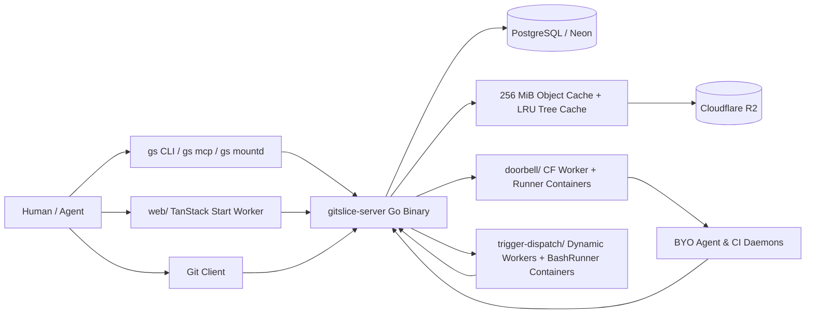

# Gitslice Architecture Design

## 1. Overview

Gitslice (`gs`) is a cloud-native, Git-compatible version control system for
large multi-account codebases, repository-like slices, virtual workspaces,
changeset-based collaboration, and agent/CI automation.

The central architectural principle is:

```text
Native global source graph first.
Git compatibility at the boundary.
```

Gitslice is not implemented internally as a Git server. Git clients see ordinary
Git repositories through a projection gateway, while the source of truth is
PostgreSQL (Neon) for transactional metadata and derived indexes, plus
Cloudflare R2 (`internal/objectstore/r2`) for content-addressed immutable blobs
and tree nodes.

Companion documents:

- [00_product.md](00_product.md): product overview, workflows, and full document map
- [02_storage.md](02_storage.md): object model, PostgreSQL schema, R2 + caches, and 3-stage publish
- [03_core_api.md](03_core_api.md): gRPC and ConnectRPC API across all 13 services
- [04_cli_design.md](04_cli_design.md): native `gs` CLI, workspaces, and `gs mcp`
- [05_git_compatibility.md](05_git_compatibility.md): Git Smart HTTP gateway, projections, and push-to-changeset
- [06_indexing.md](06_indexing.md): derived indexes, transactional outbox, and rebuilds
- [07_conflict_resolution.md](07_conflict_resolution.md): per-path conflict detection, `merge_on_submit`, and batched submit
- [13_file_identity_and_move_history.md](13_file_identity_and_move_history.md): stable file/directory identity and move history

### 1.1 System Context Diagram



---

## 2. Deployment And Runtime Components

Rather than splitting the backend into a dozen network-hop microservices,
Gitslice runs a **single Go server binary** for all control-plane, data-plane,
and Git-gateway traffic, paired with focused CLI/runner binaries and Cloudflare
edge workers.

### 2.1 Go Binaries (`cmd/`)

- **`cmd/gitslice-server`** (`server/server.go`): the production server (deployed
  on Cloud Run). Multiplexes HTTP/2 `h2c` gRPC and HTTP/1.1+HTTP/2 on a single
  listener (with optional separate `HTTPAddr` / `GitHTTPAddr` listeners):
  - **13 gRPC services** registered in `server/server.go` (`AuthService`,
    `RepositoryService`, `BlobService`, `SliceService`, `WorkspaceService`,
    `ChangesetService`, `ChangesetStackService`, `AgentService`, `CheckService`,
    `SecretService`, `FeedbackService`, `AutomationService`,
    `AutomationRunService`) plus standard `grpc.health.v1.Health`.
  - **ConnectRPC HTTP adapters** (`server/connect.go`, generated by
    `server/internal/connectgen`) exposing the same 13 services to browsers,
    Cloudflare Workers, and HTTP clients without `grpc-gateway`.
  - **Git Smart HTTP** mounted at `/git/` (`server/gateway.go`,
    `internal/gitcompat`), including signed self-requests (`GITSLICE_SELF_URL`)
    for background Git cover compaction and outbound Git mirror pushes.
  - **Auxiliary HTTP routes**: `/avatars/` (`server/avatar_image.go`), `/og/`
    (`server/social_image.go`), `/automation-archive` (per-run bearer-authenticated
    tarball checkout for bash automations), `/healthz`, `/readyz`, and `/metrics`
    (Prometheus, protected by `GITSLICE_METRICS_TOKEN`).
- **`cmd/gs`**: the native CLI, including workspace commands (`gs init`,
  `gs init --lazy`, `gs status`, `gs diff`, `gs sync`), changeset/stack commands
  (`gs create`, `gs modify`, `gs submit`), agent/auth commands
  (`gs auth login`, `gs auth register-agent`), the embedded MCP server
  (`gs mcp`), the FUSE mount daemon (`gs mountd`), and BYO agent/CI daemon modes.
- **`cmd/gitslice-admin`**: operator CLI for migrations, administrative
  inspection, and maintenance tasks.
- **`cmd/gs-exec`**: minimal container PID 1 runner embedded into Cloudflare
  Container images to execute bash automations cleanly and stream logs/status
  back to `AutomationRunService`.

### 2.2 Cloudflare Edge Components

- **`web/`**: TanStack Start SSR web application deployed on Cloudflare Workers,
  communicating with `gitslice-server` via ConnectRPC (`@connectrpc/connect-web`)
  and Clerk authentication (`@clerk/tanstack-react-start`).
- **`doorbell/`**: Cloudflare Worker with Durable Objects (`Bell` for
  hibernating WebSockets that wake detached CI daemons when checks are queued,
  and `Runner` for Cloudflare-hosted container CI runners).
- **`trigger-dispatch/`**: Cloudflare Worker for `.gitslice/automations.yaml`
  execution: runs JavaScript automations in isolated Dynamic Workers (`LOADER`)
  and bash automations in single-run `BashRunner` Durable Object Containers
  booting `gs-exec`.
- **`agents/`**: Cloudflare Artifacts prototype exploring serverless agent
  workflows (see [22_agents_on_artifacts.md](22_agents_on_artifacts.md)).

### 2.3 Storage And Caching

- **PostgreSQL (Neon)**: source of truth for refs, commits, slice definitions,
  changesets, patchsets, path heads, pending publish queue, transactional
  outbox, derived path/entity indexes, blame snapshots, checks, automations,
  encrypted secrets, and auth/group metadata.
- **Cloudflare R2 (`internal/objectstore/r2`)**: durable object store for
  immutable blobs and canonical `gitslice.tree.v1` tree nodes. Production
  enforces `GITSLICE_REQUIRE_R2=1` so the server refuses to start with the
  local filesystem object store (`internal/objectstore/filesystem`), which is
  reserved for local dev and tests.
- **In-process caches**:
  - **256 MiB object cache** (`internal/objectstore/cache`, default
    `GITSLICE_OBJECT_CACHE_BYTES=256<<20`, max 4 MiB per entry) wrapping R2.
  - **LRU decoded tree-node cache** (`internal/treestore/node_cache.go`,
    200,000-entry budget) caching immutable decoded `treestore.Node` structs so
    repeated path lookups and directory listings avoid JSON decoding and R2
    round trips.

### 2.4 Scale-To-Zero Idle Gating (`internal/activity`)

Cloud Run throttles CPU between requests but does not stop background
goroutines, which would otherwise poll Neon continuously and prevent
scale-to-zero. `internal/activity.Gate` (`activity.Default`, `IdleAfter = 5m`,
started idle via `ResetIdle()`) wraps all non-probe HTTP/gRPC/Git traffic:

- Exempt paths (`/healthz`, `/readyz`, `/metrics`, `OPTIONS`,
  `/grpc.health.v1.Health/*`, and idle `AgentService/Connect` streams) do not
  wake the gate.
- All background database loops — **async publisher** (`runPublisher`), **index
  worker** (`indexworker.Worker`), **event dispatcher** (`events.Dispatcher`
  for automations and Git mirrors), **blame warmer** (`RunBlameWarmer`), and
  **check dispatch sweep** (`RunCheckDispatchSweep`) — wait on `activity.Default`
  and stop querying PostgreSQL once the server has been idle for 5 minutes.
- Because all pending work is durable in PostgreSQL, the next user request
  wakes the gate and resumes draining immediately.

---

## 3. Global Namespace And Slice Model

### 3.1 Accounts Own Top-Level Namespaces

Every file and directory has one canonical absolute global path rooted under a
globally unique account slug:

```text
/{account}/...
```

Examples: `/nicholas/services/identity/auth.go`, `/acme/payment/api/handler.go`.
Account kind (`user` or `org`) is metadata, not part of the path. There are no
`/users`, `/orgs`, `/shared`, or `/system` prefixes.

### 3.2 Slices Are Repository-Like Projections

A slice (`{account}/{slice}`) is a versioned projection over one or more
canonical `included_paths` within its owning account (for example, the default
personal slice `nic/home` includes `/nic`). Slices never remap paths to custom
mount aliases; checkouts and Git projections preserve the canonical path layout
minus the leading `/`.

A versioned `SliceDefinition` holds:

- `included_paths`: canonical prefixes under `/{account}`
- `visibility`: `private`, `account`, or `public`
- `required_approvals` and `required_human_approvals`
- `approvers`: optional `@account/group` whose approvals satisfy approval gates
- `required_checks`: slice-level required check names

Slice metadata also tracks `merge_on_submit`, `archived`, `description`,
`former_names` (aliases after rename), CI daemon pools (`slice_ci_daemons`,
falling back to `account_ci_daemons`), tags, members/group members, and Git
mirror config.

### 3.3 Overlapping Slices And Coverage

Multiple slices in the same account may include overlapping paths.

- **Read exposure**: evaluated through the slice being read. Effective exposure
  for a global path is the broadest visibility of any covering slice.
- **Write containment**: every changeset has exactly one authoring slice, and
  every changed path must be contained by that authoring slice. Cross-slice and
  cross-account changesets are rejected.
- **History projection**: default slice history projects global commits touching
  the slice's *current* `included_paths` via the `commit_changed_paths` and
  entity-history indexes. Projection caches are keyed by
  `(slice_id, slice_definition_hash, global_commit_id)`.

---

## 4. Folder-Level `.gitslice/` Configuration

In addition to slice-level metadata, Gitslice supports hierarchical in-tree
configuration files inside `.gitslice/` directories (`internal/gitslicecfg`).
For any changed path, the server walks ancestor directories up to the account
root (`/{account}/.../.gitslice/<file>`) with bounded reads and memoized YAML
parsing:

- **`.gitslice/owners.yaml`**: path-scoped code owners and approval requirements
  for files under that directory.
- **`.gitslice/checks.yaml`**: declarative CI check definitions (commands,
  `required: true`, secret bindings, triggers) resolved along the changed paths'
  ancestor chain and dispatched to slice/account CI daemon pools or Cloudflare
  runners.
- **`.gitslice/automations.yaml`**: event-driven and manual automations
  (`worker` JS scripts, `bash` containers, `http` targets, and reusable
  pipelines) executed via `trigger-dispatch/`.
- **`.gitslice/merge.yaml`**: per-path merge strategies applied during
  server-side `merge_on_submit` and stack restack operations.

---

## 5. Workspace Model

A workspace is a local working area bound to exactly one slice:

- **Eager sparse workspace (`gs init <account>/<slice>`)**: hydrates the slice's
  included paths to local disk with `.gs/` metadata and local change tracking.
- **Lazy FUSE workspace (`gs init --lazy <account>/<slice>`)**: mounts a
  virtual filesystem via `gs mountd` that fetches blobs on demand and tracks
  local overlay edits without downloading the entire slice upfront (see
  [30_lazy_workspaces.md](30_lazy_workspaces.md)).

Client-side state and caches improve responsiveness, but server-side validation
is always authoritative.

---

## 6. Changesets, Patchsets, And Lifecycle

Users and agents do not write commits directly; all normal writes flow through
changesets and immutable patchsets.

- **Changeset handle**: `<account>/<slice>@<number>` (e.g. `acme/payment@42`).
- **Patchset handle**: `<account>/<slice>@<number>.<patchset>` (e.g.
  `acme/payment@42.2`).
- **Stacks**: dependent changesets can be grouped in a `ChangesetStack`
  (`ChangesetStackService`) with ordered restacking and stack submission.
- **Collaboration**: changesets support explicit collaborators, author handoffs,
  and advisory path intents (`path_intents`) for multi-agent coordination.

### 6.1 Changeset Statuses And `submit_blocked_code`

The persisted changeset `status` values are:

- **`draft`** (presented as **open** in user-facing surfaces): active changeset
  accepting new patchsets, approvals, check runs, and submit attempts.
- **`pending_publish`**: admitted by durable path-head CAS and queued in
  `pending_publish` for asynchronous commit publication.
- **`submitted`**: published to the target ref with a final `submitted_commit_id`.
- **`abandoned`**: closed without landing.

When a `draft` changeset cannot submit, the server records a typed
`submit_blocked_code` (`internal/storage/submit_requirements.go`) alongside
`submit_blocked_reason`:

- `stale_path_base`: one or more changed paths drifted on the target ref since
  the patchset's base fingerprint (can be resolved automatically when
  `merge_on_submit` is enabled and merge succeeds cleanly).
- `requirements_changed`: the authoring slice definition or `.gitslice/`
  requirements changed while the changeset was open, or a changed path fell
  outside the latest slice definition.
- `approvals_missing`: required slice or `.gitslice/owners.yaml` approvals
  (including `required_human_approvals` / `approvers` group) are not satisfied.
- `checks_missing`: one or more required slice or `.gitslice/checks.yaml`
  checks have not passed on the current patchset.
- `blocked_on_parent`: a stacked changeset's parent in the stack has not yet
  submitted.

Transient requirement blocks (`approvals_missing`, `checks_missing`) clear
automatically when the missing approval or passing check arrives for the current
patchset.

---

## 7. Direct Submit Validation And Asynchronous Publication

Submit validation and commit publication are decoupled so hot target refs can
admit non-conflicting changesets concurrently without holding a global commit
lock:

1. **Admission (`SubmitChangeset`)**: validates authoring slice containment,
   slice definition + `.gitslice/owners.yaml` + `.gitslice/checks.yaml`
   requirements, approvals, and checks. If path bases drifted and
   `merge_on_submit` is enabled, the server attempts a three-way merge (guided
   by `.gitslice/merge.yaml`) to produce a fresh patchset. Otherwise it performs
   durable **path-head CAS** on `path_heads`, advances each changed path's
   accepted fingerprint, marks the changeset `pending_publish`, and inserts a
   `pending_publish` row in one PostgreSQL transaction.
2. **Asynchronous 3-stage publish (`PublishPending`)**: the background publisher
   claims a batch of `pending_publish` rows for one `target_ref`, builds the
   deterministic commit chain in memory using `treestore.ApplyEditChain` (with a
   single batched flush to R2), and finalizes the batch in a short PostgreSQL
   transaction that locks the ref with `FOR NO KEY UPDATE`, inserts commits,
   marks changesets `submitted`, writes `outbox` and event rows, and advances
   `refs.commit_id` via CAS. See [02_storage.md](02_storage.md) for details.
3. **Post-landing fan-out**: the index worker drains `outbox` into
   `commit_changed_paths` and entity-history tables; the event dispatcher fires
   matching automations and queues outbound Git mirror pushes; the blame warmer
   precomputes blame snapshots for touched files.

---

## 8. System Invariants

1. Committed blobs, tree nodes, and commits are immutable and content-addressed
   (`sha256:<hex>` with domain separators).
2. Native commit, tree, and blob ids are never Git object ids.
3. A commit points to exactly one `root_tree_id`; PostgreSQL stores `root_tree_id`
   metadata rather than per-commit file listings.
4. Target-ref updates are atomic and conditional (CAS on `refs.commit_id`).
5. A single target-ref publish batch either publishes all commits in its chain
   and advances the ref, or releases its claims and publishes none.
6. Every changeset has exactly one authoring slice; multi-slice changesets are
   rejected.
7. Effective read exposure for a path is the broadest visibility of any
   covering slice.
8. A slice projection and its synthetic Git commit ids are deterministic for a
   given `(slice_id, slice_definition_hash, global_commit_id)`.
9. Metadata must never reference an unverified blob.
10. Derived indexes (`commit_changed_paths`, entity move tables, blame
    snapshots) are rebuildable from commits, trees, and blobs.

---

## 9. Unimplemented Future Items

The following items are intentionally **not implemented** in the current system
and remain future design extensions:

- **Path locks** (`gs lock`): explicit write locks for high-risk paths or large
  binaries (superseded for agent coordination by advisory `path_intents`).
- **Multi-region replication**: active-passive or active-active regional
  metadata/object replication (current production runs single-region Neon
  PostgreSQL + globally distributed Cloudflare R2 and edge Workers).
- **`gitslice.tree.v2` (embedded `entity_id` in tree entries)**: current tree
  nodes use `gitslice.tree.v1` without per-entry `entity_id`; file/directory
  move identity is tracked in PostgreSQL (`fs_entities`, `current_path_entities`,
  `commit_entity_changes`).
